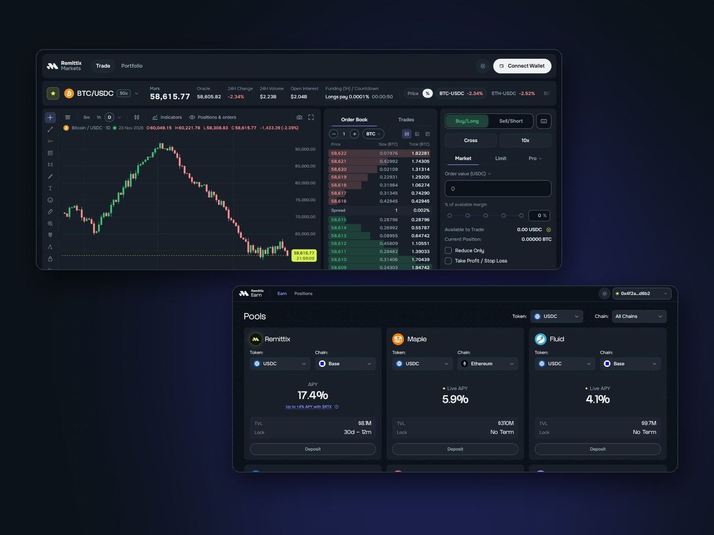

# Remittix: one wallet to pay, earn and trade

Remittix started as a payments protocol: send crypto, and the recipient gets local currency in their bank account. It grew into an ecosystem where one wallet pays, earns and trades. That meant a new marketing site and two new products on one design system: **Earn**, where users lock stablecoins or ETH for a fixed rate, and **Markets**, a perpetuals exchange with up to 50x leverage.

This repository is the product and design process behind that work, with excerpts from the front ends. The full source and the client's backend are not included.

## Roles

| | |
|---|---|
| **Srdjan Nikšić** | Product lead, creative direction and lead product designer since 2022. Set the product direction, the flows, the design principles and the design system, and reviewed every release. |
| **Filip Mravić** (Diversify) | Design execution and front-end build, and continued the design within that direction. |
| **Process** | Figma first, then front ends built with Claude Code against written design rules, reviewed on live builds. |
| **Stack** | React 19, Vite, TypeScript, Vercel |

## Live builds

| Product | Link |
|---|---|
| Marketing site | https://remittix-site.vercel.app |
| Earn | https://remittix-earn.vercel.app |
| Markets | https://remittix-markets.vercel.app |

## The product problem

Paying, earning and trading ask for very different levels of attention and risk, and all three had to feel like one product.

| Product | What it had to get right |
|---|---|
| Earn | **Yield needs trust.** Rate, lock term and early-exit rules have to be clear before anyone deposits. |
| Markets | **Trading needs density.** Chart, book and ticket on one screen, without the noise of a pro terminal. |
| Site | **One brand across all.** Moving from the site into an app should never feel like a different product. |

The thread through all of it: **money decisions made clear.** What users get, what it costs and what can go wrong, before they commit.

## The process

| # | Step | What is in it |
|---|---|---|
| 01 | [Principles and exploration](process/01-principles-and-exploration.md) | Four design principles, three hero directions, and what was removed because it read as a template |
| 02 | [Flows](process/02-flows.md) | Earn from pool to position, the early-exit rule, five position states, Markets confirm before every order, the mobile ecosystem |
| 03 | [Design system](process/03-design-system.md) | One token set, two themes, the color jobs, type, motion and loading rules |
| 04 | [Design to code](process/04-design-to-code.md) | The written rules the front ends follow, and code excerpts that show design decisions held in code |

---

Remittix, its name and marks belong to Remittix. Screens show demo data.

Srdjan Nikšić · [Portfolio](https://srdjan-portfolio-five.vercel.app) · [Behance](https://www.behance.net/srdjanniksic) · [LinkedIn](https://www.linkedin.com/in/srdjan-niksic)
