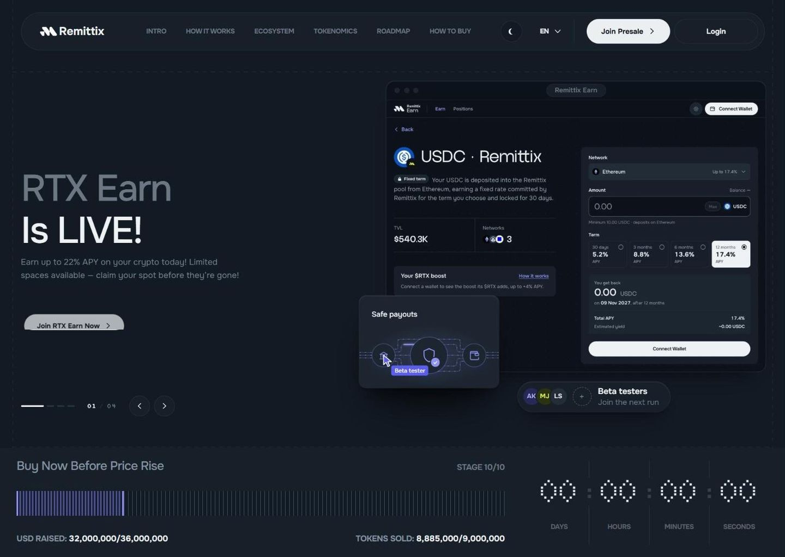
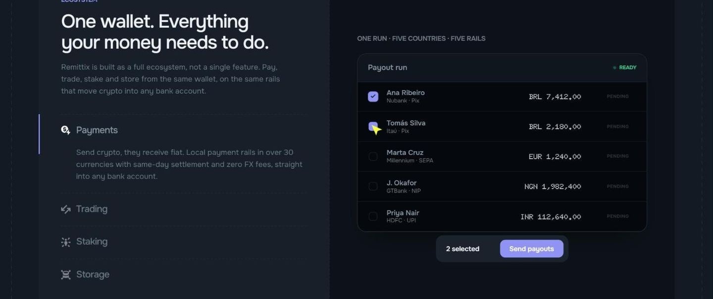

# 01 Principles and exploration

## Four principles

| | Principle | What it means on screen |
|---|---|---|
| Clarity | **Numbers first** | APY, TVL, mark price and funding sit at the largest size on each screen. |
| Trust | **Terms before the button** | Lock length, early exit and custody are stated before a deposit can be sent. |
| Signal | **Lime means live** | Lime is kept for the connected state, live rates and the Remittix mark. Nothing else. |
| System | **One token set, two themes** | Every color has a dark and a light value. Dark is the default. |

## The hero: three directions

The brief for the site hero: crypto in, local currency out, paid into bank accounts in 30+ countries. The client wanted a globe with coins in transit and nothing that reads as templated. Three directions were drawn as layouts before any visual design.

```
1 Ledger: left-aligned, two columns
Send crypto.                       .  .  .  .
It arrives as money.            .  o  o  o  o  .
paragraph, under 70ch          .  o  o  o  o  o  .
[Join the presale]  How it works   .  o  o  o  .
• Presale closes in 42 days           .  .  .

2 Orbit: centred, planet rising
              Pay any bank account
               from your wallet.
              [Join the presale]
            .  .  o  o  o  o  .  .
─────────o──o──o──o──o──o──o──o──o────── hero edge

3 Stage: product window
Crypto to bank,        ┌──────────────────────┐
in minutes.            │      .  o  o  o  .    │
[Join the presale]     │    o  o  o  o  o  o   │
                       │ BTC→NGN Lagos 38s ... │
                       └──────────────────────┘
```

Rules every direction kept:

- One memorable object: the globe with coins in transit. Everything else is quiet.
- Indigo is spent exactly once per direction.
- The only motion: the globe turns and the coins orbit. No pointer parallax, no per-section entrances.
- Line length under 70 characters. Body text darkened from `#8A8F98` to `#5B636B`, because the old grey failed contrast at 18px.

## What was removed because it read as a template

The previous hero had a tracked-out all-caps eyebrow, one word of the headline in the accent color, an arrow appended to the primary button, a three-up big-number stat row, a system font stack and a pointer parallax. All of it was removed. Numbers now live inside sentences.

What stayed because it is brand, not default: the `#EDEFF1` ground with its dot grid, the ink black and the lime corner marks.



| | |
|---|---|
|  Bridging crypto with local payment networks |  Ecosystem: a payout run across five countries |

Next: [02 Flows](02-flows.md)
