# 02 Flows

## Earn: from pool to position

| # | Step | What the user sees |
|---|---|---|
| 01 | Pick a pool | The Remittix fixed-term APY next to live APYs from Maple, Fluid, Morpho, Spark and Aave v3, with TVL and lock for every pool. |
| 02 | Set network, amount and term | The APY for every term up front, then what you get back, when, and the $RTX boost. |
| 03 | Track and claim | Deposited, accrued yield, blended APY and next maturity, then one card per position. |

| Pools | Deposit | Positions |
|---|---|---|
| 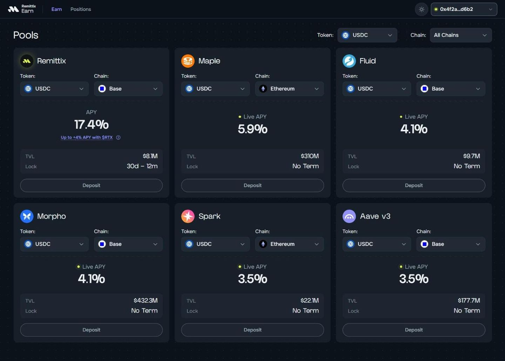 | 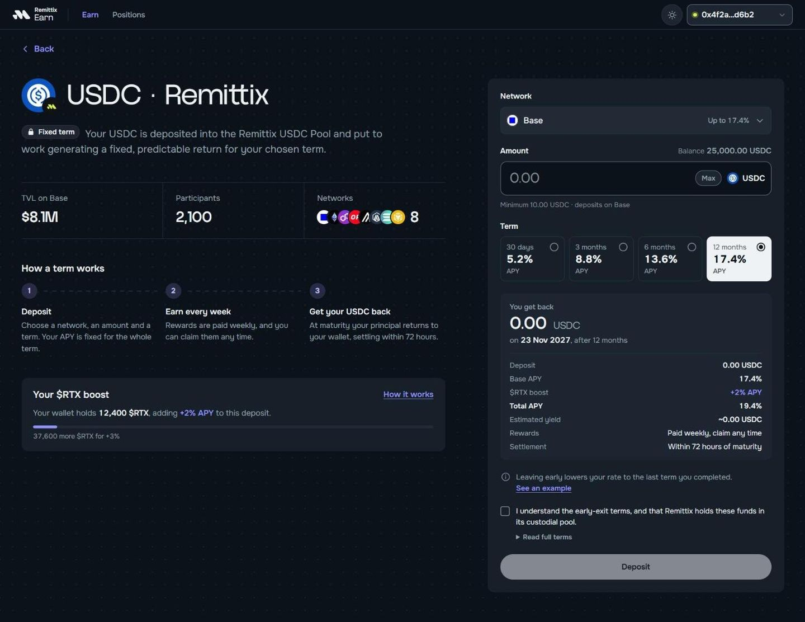 | 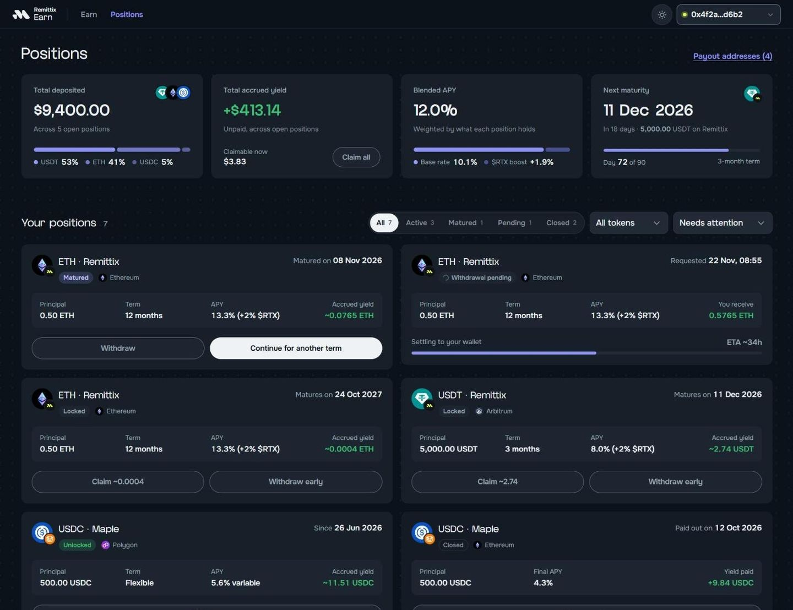 |

## Terms before the button

Two kinds of pool, and the deposit page switches on which one it is:

| | Fixed term (Remittix) | Flexible (other protocols) |
|---|---|---|
| Rate | Set per term, with an $RTX boost | Live APY set by the protocol |
| Leaving | Allowed, under the early-exit rule | Any time |
| Settlement | Within 72 hours | Within 24 hours |

**The early-exit rule** is the hardest thing in Earn to explain, and it is explained before the deposit, not after. Leaving early lowers your rate to the last term you completed. The page shows that in one line with a worked example one tap away, and the deposit cannot be sent until the user ticks that they understand it and that Remittix holds the funds in its custodial pool.

## Five position states

Every position is always in exactly one state, and each state says what the user can do next.

| State | Meaning | What the user can do |
|---|---|---|
| Locked | A fixed term that has not matured | Claim weekly rewards, or leave early under the rule |
| Unlocked | A flexible position | Withdraw any time |
| Matured | The term is over | Withdraw in full, or roll over |
| Pending | A withdrawal is settling | Wait, with the settlement time shown |
| Closed | Paid out | Nothing; it stays in the history |

Payout addresses have their own states too: added, under review, a 24-hour cooldown, whitelisted, or rejected with a reason.

## Markets: a last look before every order

The order form shows margin, fees and the liquidation price while the trader types. Before the order is sent, a confirm dialog repeats every figure it will be sent with, then shows the position the order leaves behind, including its liquidation price.

A trader can turn confirmations off for everyday orders. **Risky orders always confirm**, and the dialog says why it is asking.

| Trade | Connect a wallet |
|---|---|
| 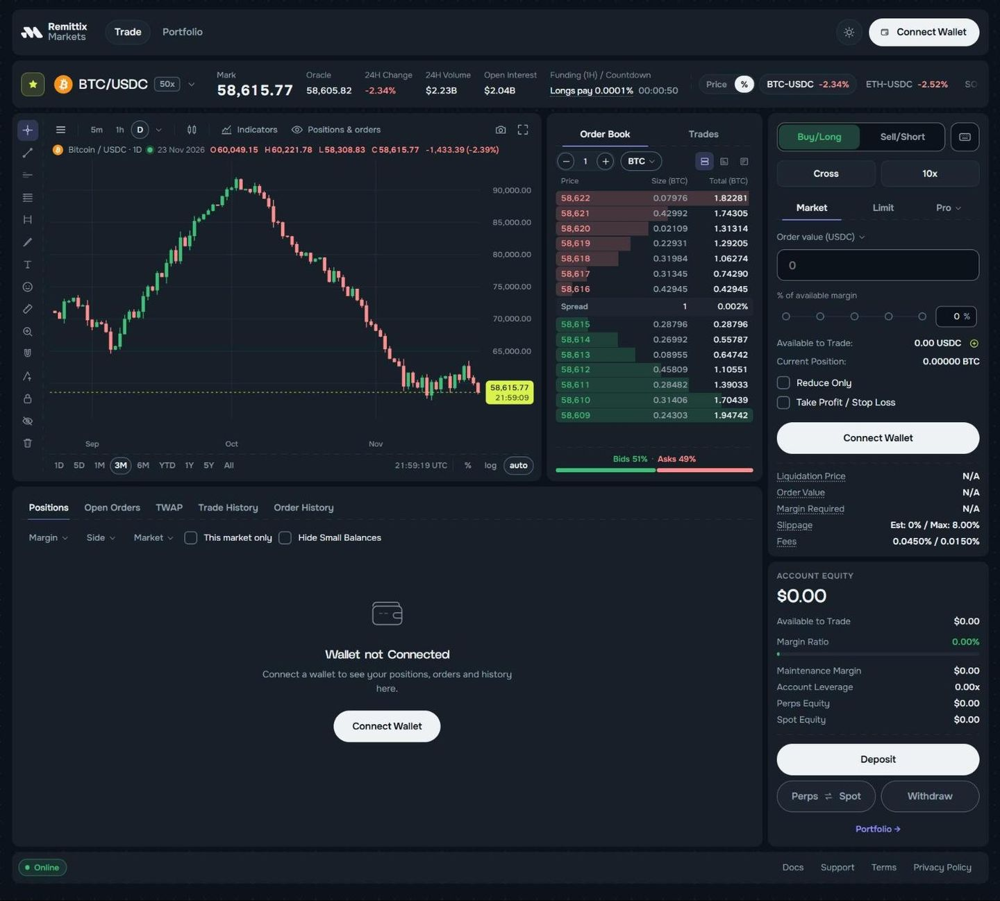 | 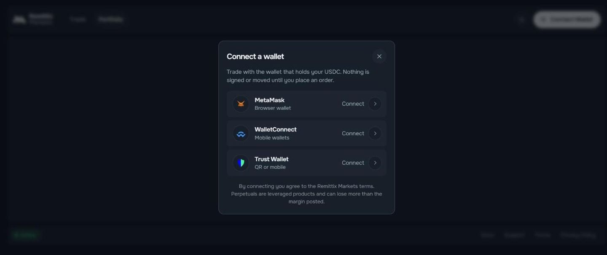 |

## The ecosystem on a phone

| Site | Earn pools | Deposit | Positions | Markets | Light |
|---|---|---|---|---|---|
|  | 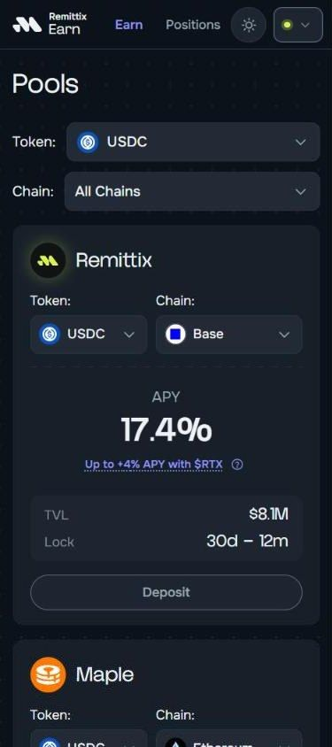 | 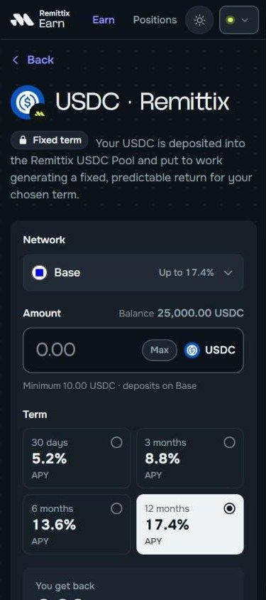 | 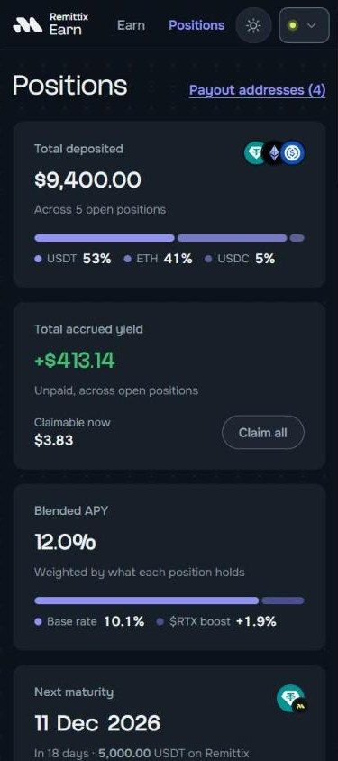 | 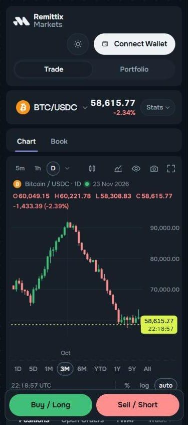 | 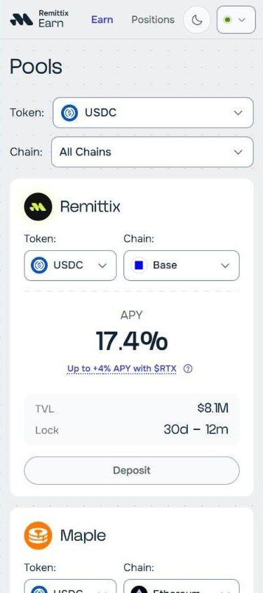 |
| The Earn launch as the hero | One pool per card | Network, amount and term stacked for one thumb | Totals first, then each position | Chart and book as tabs, Buy and Sell pinned to the bottom | The same tokens with their light values |

## The presale dashboard

The same system carries the presale dashboard: stats, the stage ladder, buying, referrals and live orders, in both themes.

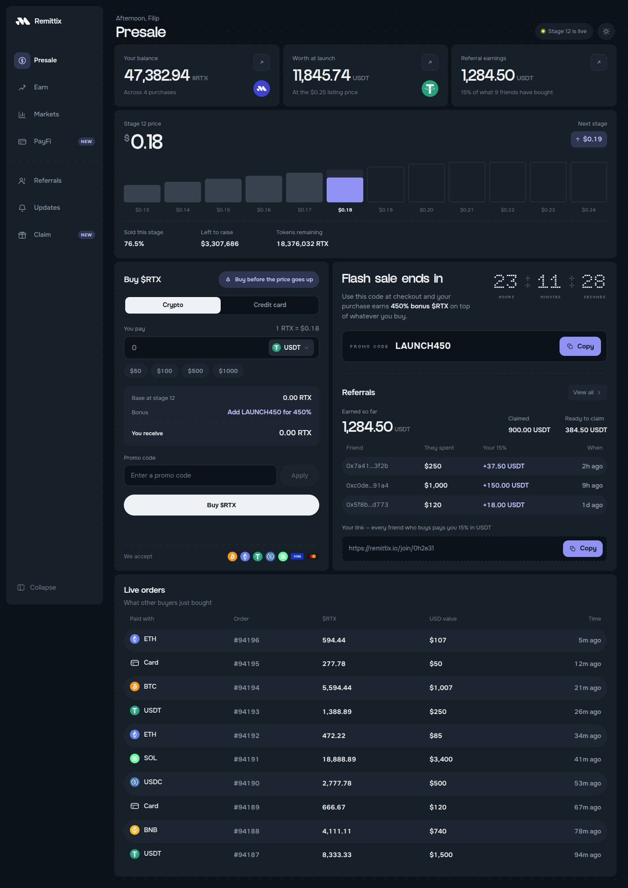

Next: [03 Design system](03-design-system.md)
