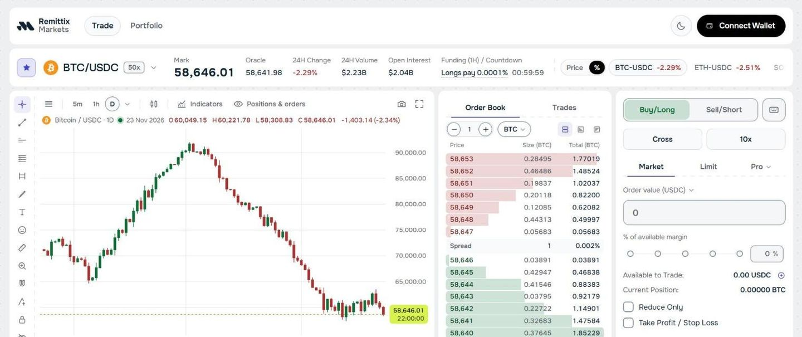
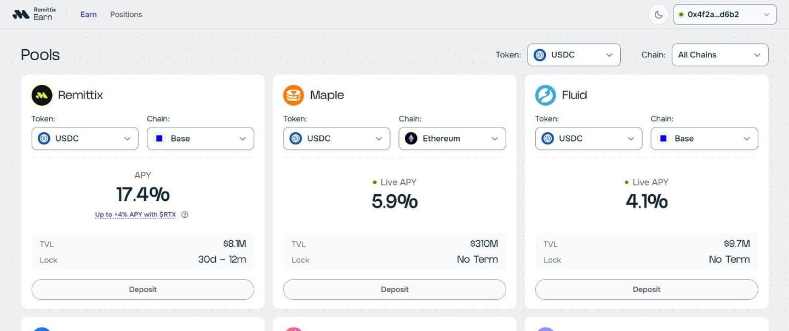
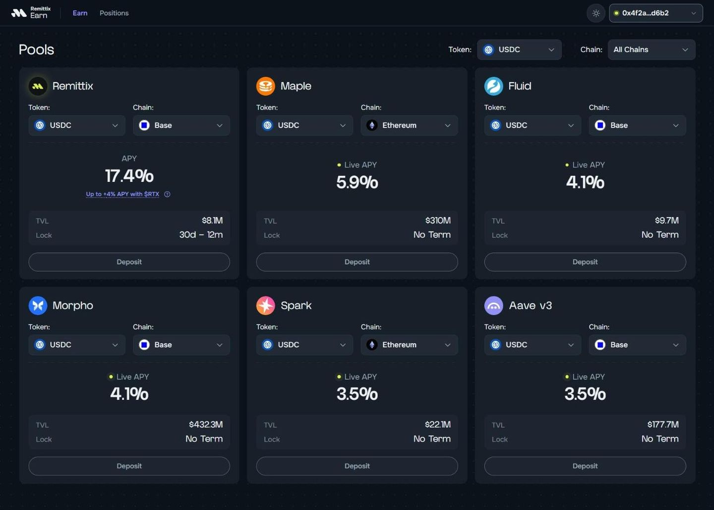

# 03 Design system

Earn and Markets share one palette, one type family and one component set, with every token in a dark and a light value. The foundations and components live in Figma for both apps, and the same tokens run the code (`--d-*` for the shared dashboard roles).

## Color jobs

| Token | Dark | Job |
|---|---|---|
| Ground | `#0C1219` | Page |
| Card | `#171F29` | Surfaces |
| Inset | `#1D2630` | Fields and nested surfaces |
| Indigo accent | `#9092F4` | Actions and links |
| Live lime | `#D9F24E` | Connected state, live rates, the mark. Nothing else. |
| Up | `#3FBF77` | Direction only |
| Down | `#FF8F8F` | Direction only |

The up and down colors stay text-safe at 4.5:1 in the light theme, including on a pinned or selected row and during a price flash.

## Type

| Family | Role |
|---|---|
| NewBlack | Display |
| Onest | Text and UI, 400 to 600, 11 to 56px |
| JetBrains Mono | Wallet addresses |

## What is not allowed

- Gradient borders, glows, lime-on-ink highlights or other decorative "premium" treatments on components.
- Colored side stripes, red washes or red-bordered boxes for warnings. Warnings are one inset row with a round glyph in the down color and the consequence in bold.
- Reference screens used for their colors. References are for content and behavior only.

## Motion and loading

- Things arrive on an ease-out and leave on an ease-in, travel 4 to 8px, scale no lower than 0.96, and only transform and opacity move.
- Every animation ends at once under reduced motion.
- **Live figures never count up.** Prices, the order book and PnL flash the way they moved. Totals count only after the trader's own action.
- A screen that loads gets a skeleton built from its own markup, so nothing moves when the data lands.
- Empty states use one family of drawings, with the missing part dashed.

| Earn, light | Pools, dark |
|---|---|
|  |  |

Next: [04 Design to code](04-design-to-code.md)
